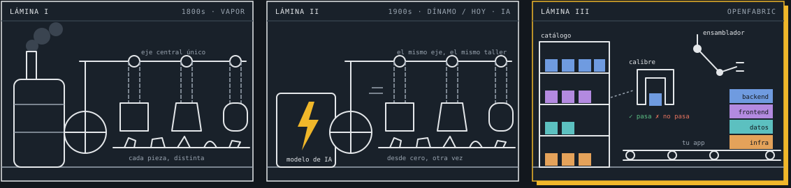

# OpenFabric

**Una fábrica de código abierto de piezas de software verificadas, que los agentes de IA ensamblan en vez de escribir todo desde cero.**

[English](README.md)

> Estado: investigación. Estamos probando la tesis con un experimento público y reproducible antes de construir el producto. Aquí todavía no hay software para producción.

## La idea: de taller a fábrica

Hoy un agente de IA escribe cada sistema desde cero y a medida. Es un motor eléctrico metido en un taller de vapor: va más rápido, pero el taller sigue igual. OpenFabric es la fábrica: el software se arma con piezas que ya se sabe que funcionan.



- **1. A medida (vapor, siglo XIX).** Una caldera mueve todo el taller con un solo eje. El artesano lima cada pieza hasta que encaja, y ninguna sirve para otra máquina. *El software antes de la IA: cada equipo escribe a mano su checkout, su webhook y su login.*
- **2. Más rápido, el mismo taller (dínamo, 1900; IA, hoy).** Las primeras fábricas eléctricas cambiaron la caldera por un motor y dejaron todo lo demás igual. La productividad casi no subió en décadas: la paradoja del dínamo. *El software hoy: el agente reescribe todo desde cero en cada proyecto y gasta tokens reinventando el mismo webhook.*
- **3. Piezas y calibre (OpenFabric).** Las piezas son estándar y están en estantes. Antes de entrar a la línea, un calibre dice si pasan o no. El ensamblador arma el producto completo, capa por capa, en tu stack. *Tu software se arma con piezas probadas y solo se hace a medida lo que de verdad es tuyo.*

### Qué es cada cosa

| En la fábrica | En OpenFabric |
| --- | --- |
| Pieza intercambiable | Una parte de software que ya se sabe que funciona: un cobro, un login, un carrito, una app entera |
| Calibre "pasa / no pasa" | La garantía de que la pieza hace lo que promete, en cualquier lenguaje o framework |
| Estantes | El catálogo, desde piezas chicas hasta sistemas completos de una industria |
| Ensamblador en la línea | Tu asistente de IA, que arma en vez de reinventar |
| Ajuste a mano que queda | Lo que hace único a tu producto. Ahí va el esfuerzo |
| Motor eléctrico | La IA. Es la energía, no la fábrica |

El calibre es lo que hace intercambiables las piezas: sin él seguís en el taller de vapor. La analogía histórica sigue a Paul David, "The Dynamo and the Computer" (1990).

## Primer paso: ¿de verdad ayuda?

[`bench/`](bench) es el experimento. Un modelo pequeño construye el mismo servicio de checkout en Next.js, Django, Spring Boot y Laravel, con y sin una pieza de OpenFabric, y dos suites ocultas juzgan cada resultado: 21 tests HTTP y otros 26 escritos de forma independiente, solo a partir de la tarea. Mide tokens por test pasado. Ver [bench/README.es.md](bench/README.es.md).

## Estructura

```
bench/      el experimento: tarea, brazos, juez, harness e implementaciones de referencia
docs/       contexto y decisiones
LICENSE     Apache 2.0
```

## Licencia

Apache 2.0. Ver [LICENSE](LICENSE).
