# OpenFabric

**Una fábrica de código abierto de piezas de software verificadas, que los agentes de IA ensamblan en vez de escribir todo desde cero.**

[English](README.md)

> Estado: investigación. Estamos probando la tesis con un experimento público y reproducible antes de construir el producto. Aquí todavía no hay software para producción.

## La idea: de taller a fábrica

Hoy un agente de IA escribe cada sistema desde cero y a medida. Es un motor eléctrico metido en un taller de vapor: va más rápido, pero el taller sigue igual. OpenFabric es la fábrica: el software se arma con piezas que ya se sabe que funcionan.



- **1. A medida (vapor, siglo XIX).** Una caldera mueve todo el taller con un solo eje. El artesano lima cada pieza hasta que encaja, y ninguna sirve para otra máquina. *El software antes de la IA: cada equipo escribe a mano su checkout, su webhook y su login.*
- **2. Más rápido, el mismo taller (dínamo, 1900; IA, hoy).** Las primeras fábricas eléctricas cambiaron la caldera por un motor y dejaron todo lo demás igual. La productividad casi no subió en décadas: la paradoja del dínamo. *El software hoy: el agente reescribe todo desde cero en cada proyecto y gasta tokens reinventando el mismo webhook.*
- **3. Piezas y calibre (OpenFabric).** Las piezas son estándar y están en estantes. Antes de entrar a la línea, un calibre dice si pasan o no. El ensamblador arma el producto completo, capa por capa, en tu stack. *Tu software se arma con piezas probadas y solo se hace a medida lo que de verdad es tuyo.*

### Qué es cada cosa

| En la fábrica | En OpenFabric |
| --- | --- |
| Pieza intercambiable | Una parte de software que ya se sabe que funciona: un cobro, un login, un carrito, una app entera |
| Calibre "pasa / no pasa" | La garantía de que la pieza hace lo que promete, en cualquier lenguaje o framework |
| Estantes | El catálogo, desde piezas chicas hasta sistemas completos de una industria |
| Ensamblador en la línea | Tu asistente de IA, que arma en vez de reinventar |
| Ajuste a mano que queda | Lo que hace único a tu producto. Ahí va el esfuerzo |
| Motor eléctrico | La IA. Es la energía, no la fábrica |

El calibre es lo que hace intercambiables las piezas: sin él seguís en el taller de vapor. La analogía histórica sigue a Paul David, "The Dynamo and the Computer" (1990).

## Primer paso: ¿de verdad ayuda?

La idea hace tres promesas: menos tokens para llegar a software correcto, prompts vagos que igual funcionan y cualquier stack. Cada una es una tesis por probar, no un hecho. La investigación es el medio; el fin es decidir qué construir.

**Cómo se prueba.** Cada afirmación es una tesis numerada, con un criterio de éxito escrito antes de correr el experimento. Controles que no usan modelo muestran que el experimento puede fallar, una corrida exploratoria busca pisos y techos, y el resultado se publica ayude o no a la idea. El protocolo completo está en [docs/method.md](docs/method.md) (en inglés).

**El instrumento.** [`bench/`](bench) construye el mismo servicio de checkout en Next.js, Django, Spring Boot y Laravel bajo distintos tratamientos, y dos suites ocultas juzgan cada resultado: 21 tests HTTP y otros 26 escritos de forma independiente, solo a partir de la tarea. Aquí el stack es un factor del experimento; el stack del producto se elige con los resultados. Ver [bench/README.es.md](bench/README.es.md).

**Dónde está.** Todas las corridas de la tarea completa con un modelo local de 7B sacaron cero en las suites ocultas, en todos los brazos, así que las primeras tesis quedaron indecidibles. El siguiente experimento prueba el calibre sobre una regla de negocio a la vez. Los veredictos están en [docs/theses.md](docs/theses.md) y los registros en [experiments/](experiments).

## Estructura

```
docs/          visión, método, registro de tesis, decisiones, hoja de ruta, arquitectura del instrumento
experiments/   un registro por experimento: diseño, criterios, datos, veredicto
research/      estudios de literatura y de competidores
bench/         el instrumento: tarea, brazos, juez, harness e implementaciones de referencia
LICENSE        Apache 2.0
```

La documentación está en inglés. Empieza por [docs/README.md](docs/README.md).

## Licencia

Apache 2.0. Ver [LICENSE](LICENSE).
