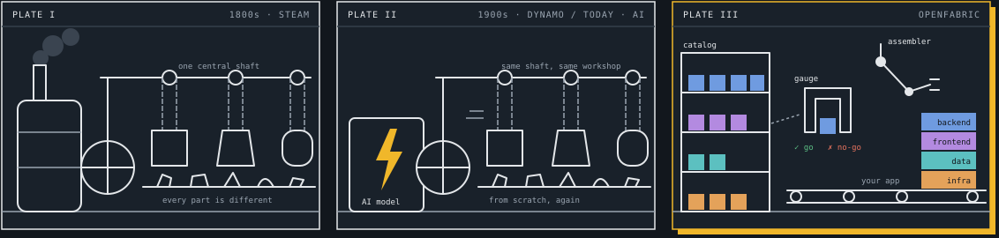

# OpenFabric

**An open-source factory of verified software pieces that AI coding agents assemble instead of writing from scratch.**

[Español](README.es.md)

> Status: research. We are testing the thesis with a public, reproducible experiment before building the product. Nothing here is production software yet.

## The idea: from workshop to factory

Today an AI agent writes every system from scratch, made to measure. That is an electric motor bolted into a steam-era workshop: faster, but the workshop has not changed. OpenFabric is the factory: software assembled from parts that are already known to work.



- **1. Made to measure (steam, 1800s).** One boiler drives the whole workshop through a single shaft. A craftsman files every part until it fits, and no part fits another machine. *Software before AI: every team writes its own checkout, webhook and login by hand.*
- **2. Faster, same workshop (dynamo, 1900s; AI, today).** The first electric factories swapped the boiler for a motor and changed nothing else. Productivity barely moved for decades: the productivity paradox of the dynamo. *Software today: the agent rewrites everything from scratch in every project and spends tokens reinventing the same webhook.*
- **3. Parts and a gauge (OpenFabric).** Standard parts sit on shelves. Before entering the line, a go/no-go gauge says whether they fit. The assembler builds the whole product, layer by layer, in your stack. *Your software is assembled from proven parts, and only what is truly yours is made to measure.*

### What each thing is

| In the factory | In OpenFabric |
| --- | --- |
| Interchangeable part | A piece of software that is known to work: a payment, a login, a cart, a whole app |
| Go/no-go gauge | The guarantee that the piece does what it promises, in any language or framework |
| Shelves | The catalog, from small pieces to complete systems for an industry |
| Assembler on the line | Your AI assistant, assembling instead of reinventing |
| Hand fitting that remains | What makes your product unique. That is where the effort goes |
| Electric motor | The AI. It is the power, not the factory |

The gauge is what makes parts interchangeable: without it you are still in the steam workshop. The historical analogy follows Paul David, "The Dynamo and the Computer" (1990).

## First step: does it actually help?

[`bench/`](bench) is the experiment. A small model builds the same checkout service in Next.js, Django, Spring Boot and Laravel, with and without an OpenFabric piece, and two hidden suites judge every result: 21 HTTP tests, plus 26 written independently from the task alone. It measures tokens per passed test. See [bench/README.md](bench/README.md).

## Repository layout

```
bench/      the experiment: task, arms, judge, harness and reference implementations
docs/       context and decisions
LICENSE     Apache 2.0
```

## License

Apache 2.0. See [LICENSE](LICENSE).
