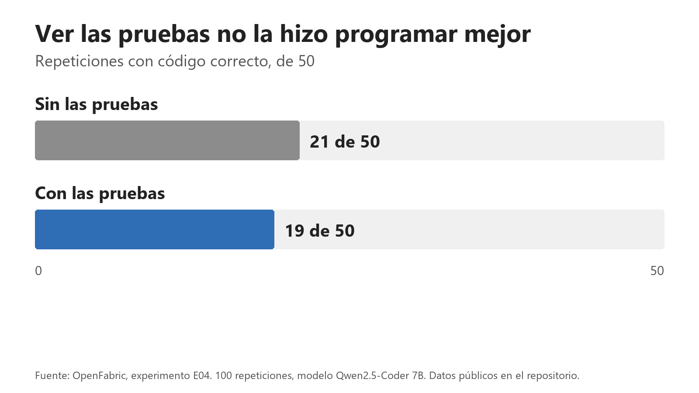
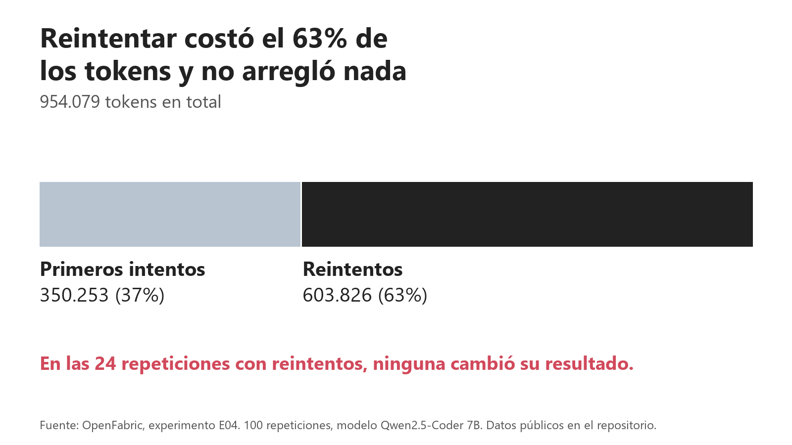
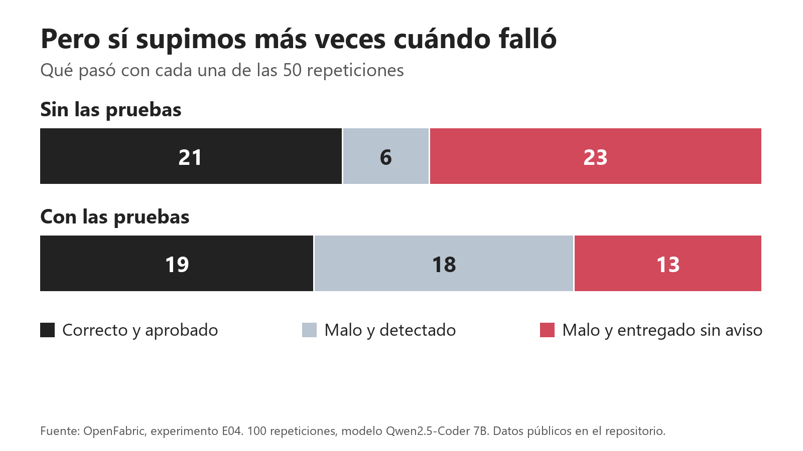
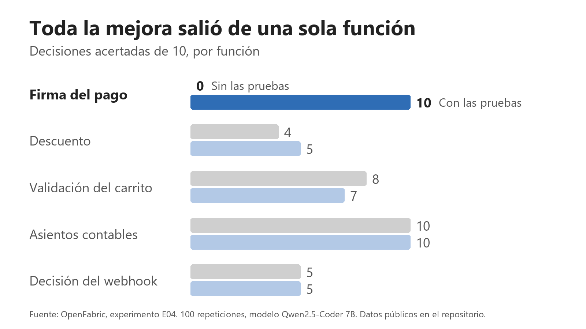

# Quise demostrar que mi idea estaba mal. Una parte se rompió, y esa es la buena noticia

A la una de la mañana, mientras yo dormía, mi computador se quedó sin memoria por segunda vez.

Iban 64 de 100 repeticiones del experimento con el que quería averiguar si mi idea servía o no. Y lo peor: antes de detenerse del todo, alcanzó a anotar cuatro resultados falsos.

Esta es la historia de cómo llegué ahí, de la parte de mi idea que murió esa noche y de la parte que sobrevivió.

## Una intuición de fábrica

En la época del vapor, las cosas se hacían a medida, una por una. Con la electricidad llegó la línea de ensamblaje: piezas ya probadas, una línea que las arma y un control de calidad que decide qué sale y qué no.

Hoy la inteligencia artificial programa como un artesano. Todo desde cero, cada vez. Y a veces entrega algo que parece bueno y no lo es.

Mi apuesta se llama OpenFabric: que la IA trabaje como una fábrica. Que arme con piezas ya verificadas, que solo escriba el pedacito que falta, y que un control de calidad, al que llamo "el calibre", diga si eso pasa o no pasa.

No soy el primero en soñar con esto. En 1968, en una conferencia de la OTAN, Doug McIlroy propuso una industria de componentes de software. La consigna de aquellos días era pasar del software hecho en casa al software manufacturado. Han pasado casi sesenta años. Lo nuevo es que ahora quien ensambla puede ser una IA.

## Por qué no me la quise creer

Me encantaba la idea. Por eso mismo no me la quise creer.

A la IA con la que trabajo le dije una frase que se volvió regla del proyecto: no quiero que me des la razón, quiero números.

Y tomamos una decisión que duele: antes de correr un solo experimento, dejamos escrito y publicado qué resultado me daría la razón y cuál me la quitaría. Con fecha, en un repositorio abierto, congelado. Así, después, no hay forma de acomodar la historia a lo que salga.

## El experimento, en simple

Tomamos un servicio de pagos, un checkout. La herramienta lo instala completo y deja un solo hueco: una función pequeña con una regla de negocio. Por ejemplo, calcular un descuento o verificar la firma de un pago. La IA solo tiene que llenar ese hueco.

Lo hicimos de dos maneras:

- **Sin las pruebas:** la IA recibe la tarea y un control básico de 4 chequeos.
- **Con las pruebas:** recibe lo mismo, más 8 pruebas públicas y sus resultados. Ese es el calibre completo, 12 chequeos.

Aparte hay un juez oculto: 47 pruebas que la IA nunca ve. Ese juez dice la verdad sobre si el código está bien.

Todo corrió en mi computador de casa, con una tarjeta gráfica de 2018 y una IA pequeña que cabe en ella. Cien repeticiones. Costo en servicios de IA: cero.

## La noche en que se cayó dos veces

Me fui a dormir y lo dejé andando. El computador se quedó sin memoria dos veces.

La segunda vez pasó algo peor que detenerse: el experimento quedó herido, siguió corriendo sin poder construir nada, y anotó cuatro repeticiones como "el código de la IA no funciona" cuando en realidad nunca lo había probado.

Aquí había una tentación. Esas repeticiones falsas, por casualidad, favorecían a mi tesis.

Las tiramos igual. Pusimos una regla que no mira el resultado: si una repetición gastó menos de 2 segundos construyendo, nunca se ejecutó de verdad, y se hace de nuevo. Entre esa regla y la revisión de la primera caída, hubo que rehacer cinco repeticiones. Después revisamos una por una las 13 que terminaron sin construir: las 13 eran errores reales de la IA.

Dejarlas habría mejorado mi número de 37 a 39. Prefiero el 37 que es verdad.

## Lo que murió

La parte que más me gustaba: que al ver las pruebas, la IA programaría mejor.

No pasó. Con las pruebas a la vista escribió código correcto en 19 de 50 repeticiones. Sin ellas, en 21 de 50.

Y hay más. Cuando se equivocaba, la dejábamos reintentar hasta completar seis intentos, mostrándole qué había fallado. En las 24 repeticiones donde reintentó, no corrigió ni una. Ahí se fue el 63% de todo lo que gastamos.

## Lo que sobrevivió

Apareció otra cosa.

Una de las funciones verificaba la firma de un pago. La IA la escribió mal las 20 veces. Con el control básico, 10 de 10 veces ese código pasó como bueno. Con el calibre completo, lo frenó las 10.

En el total, la decisión de "pasa o no pasa" acertó 37 de 50 veces con el calibre completo, contra 27 de 50 con el básico. Y el código malo entregado sin aviso bajó de 23 repeticiones a 13.

## La parte incómoda

No canto victoria, por tres razones.

Toda la mejora salió de una sola de las cinco funciones, la de la firma. En las otras cuatro hubo empate.

El calibre tiene puntos ciegos. En dos casos, el código estaba mal y pasó los 12 chequeos las 5 veces.

Y todo esto vale para una IA pequeña, dos tecnologías y cinco funciones. Con otra IA la historia puede cambiar.

## La idea que queda

El calibre no hace más inteligente a la IA.

Hace lo que hace en cualquier fábrica: no logra que la máquina corte mejor, impide que la pieza mala salga a la calle.

Eso cambia lo que hay que construir:

- **El valor es saber cuándo falló.** Un código malo que avisa se arregla. Uno que pasa callado llega a producción.
- **Una pieza vale lo que vale su calibre.** Donde el calibre cubría el error, lo atrapó siempre. Donde no, nunca.
- **Un intento y a decidir.** Con esta IA, reintentar fue plata tirada.

## Lo que sigue: dos tesis

**1. El motor.** Hace falta un modelo más inteligente. Con un motor más grande, las pruebas sí ayudarían a programar mejor y los reintentos sí corregirían. Esta cuesta plata, porque ese motor no cabe en mi computador.

**2. El calibre.** Con el mismo motor, un calibre escrito por alguien independiente dejaría pasar menos errores. Esta se puede medir ya y sin IA: tomamos las respuestas malas de esta campaña y las pasamos por otros calibres.

Voy a contar cada experimento aquí, salga bien o salga mal.

## Ficha técnica

Para quien quiera revisar todo.

**Modelo**

- Qwen2.5-Coder 7B Instruct, 7,6 mil millones de parámetros
- Cuantizado a 4 bits (GGUF Q4_K_M, 4,7 GB)
- Contexto de 32.768 tokens, temperatura 0,2, máximo 8.192 tokens de salida, semilla fija por repetición e intento
- Servido con llama.cpp (Docker Model Runner)

**Máquina**

- Tarjeta gráfica NVIDIA RTX 2070 de 8 GB
- Procesador AMD Ryzen 5 2600, 16 GB de RAM
- Unos 50 tokens por segundo al generar

**Diseño**

- Tarea: un servicio de checkout con API HTTP y PostgreSQL, en dos tecnologías, Next.js y Django
- Cinco funciones: descuento, validación del carrito, firma del pago, decisión del webhook y asientos contables
- Dos condiciones: control básico de 4 chequeos, o calibre completo de 12
- Hasta 6 intentos por repetición
- Juez: dos baterías ocultas de 21 y 26 pruebas. Una repetición es correcta solo si pasa las 47
- 2 tecnologías x 5 funciones x 2 condiciones x 5 veces cada una = 100 repeticiones, 220 intentos
- 954.079 tokens, 3 horas y 40 minutos de ejecución

**Regla de decisión, fijada antes de los datos**

- Una sola mirada, al terminar las 100 repeticiones
- Prueba exacta de Cochran-Mantel-Haenszel, estratificada por tecnología y función, unilateral, alfa 0,025
- Diferencia mínima que importa: 30 puntos
- "Refutada" si el límite superior del intervalo de la diferencia queda por debajo de 30 puntos

**Resultados principales**

- Código correcto: 19 de 50 con pruebas, 21 de 50 sin ellas. Diferencia de -4,0 puntos, intervalo de -23,1 a +15,5, p = 0,88. **Refutada**
- Decisión acertada: 37 de 50 contra 27 de 50. Diferencia de +20,0 puntos, intervalo de +0,3 a +37,6, p = 0,0018, positiva en las dos tecnologías. **Respaldada**
- "Respaldada" quiere decir mayor que cero. El estimado es 20 puntos, menos que los 30 que habíamos fijado como diferencia que importa

**Qué pasó con cada repetición, de 50**

- Correcta y aprobada: 19 con pruebas, 21 sin ellas
- Mala y detectada: 18 con pruebas, 6 sin ellas
- Mala y entregada sin aviso: 13 con pruebas, 23 sin ellas
- Correcta y rechazada por error: 0 en ambas

**Más números**

- Errores detectados: 18 de 31 con pruebas, 6 de 29 sin ellas
- Por tecnología, código correcto: Django 14 de 25 en ambas condiciones, Next.js 5 de 25 contra 7 de 25
- Por función, código correcto de 20: asientos contables 18, carrito 13, descuento 9, firma 0, webhook 0
- Reintentos: 24 repeticiones, ninguna cambió su resultado
- Tokens: 350.253 en primeros intentos y 603.826 en reintentos
- Ver las pruebas cuesta 6,9% más de tokens en el primer intento
- Tokens por repetición correcta: 32.660 con pruebas y 15.883 sin ellas. La razón es 2,06, con un intervalo de 0,43 a 9,63, así que esa tesis quedó sin decidir

**Integridad de los datos**

- Dos caídas por memoria durante la campaña
- 5 repeticiones apartadas y hechas de nuevo, con reglas que no miran el resultado
- 13 repeticiones terminaron sin construir. Las reconstruimos una por una: las 13 son errores reales del modelo
- El código que da los veredictos es idéntico al que quedó congelado antes de los datos

**Límites**

- Un solo modelo, y pequeño
- Cinco funciones. Toda la diferencia viene de una
- Las dos condiciones tienen calibres de distinto tamaño, y el experimento no separa "ver las pruebas" de "tener un calibre más grande"
- Las pruebas públicas y una de las baterías ocultas tienen el mismo autor

## No estamos solos

- M. D. McIlroy, "Mass Produced Software Components", conferencia de ingeniería de software de la OTAN, Garmisch, 1968. La idea original de una industria de componentes
- T. X. Olausson y otros, "Is Self-Repair a Silver Bullet for Code Generation?", ICLR 2024. La autocorrección rinde poco cuando se cuenta su costo
- J. Liu y otros, "Is Your Code Generated by ChatGPT Really Correct?", NeurIPS 2023. Con 80 veces más pruebas, el código "correcto" de los modelos cae entre 19% y 29%

## Todo es público

- Repositorio: https://github.com/krespokiller/Open-Fabric
- Las reglas, congeladas antes de los datos: https://github.com/krespokiller/Open-Fabric/tree/prereg/E04
- El registro completo del experimento: https://github.com/krespokiller/Open-Fabric/blob/main/experiments/E04-slot-gauge/README.md
- Los datos de las 100 repeticiones: https://github.com/krespokiller/Open-Fabric/tree/main/experiments/E04-slot-gauge/data/confirmatory

De los errores se aprende, del éxito muy poco.
