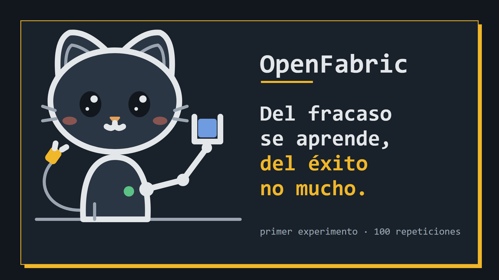
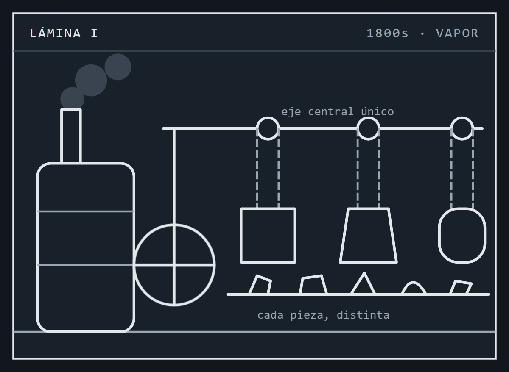
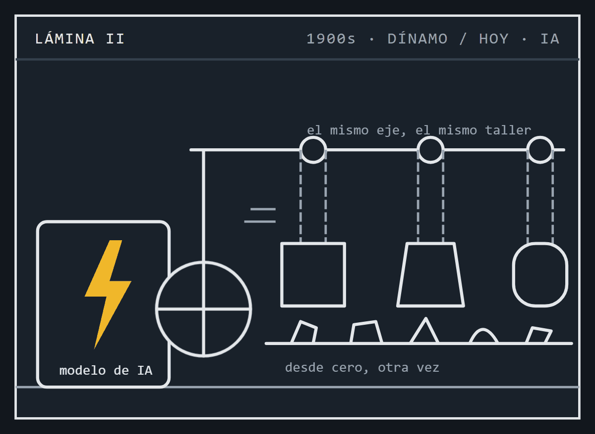
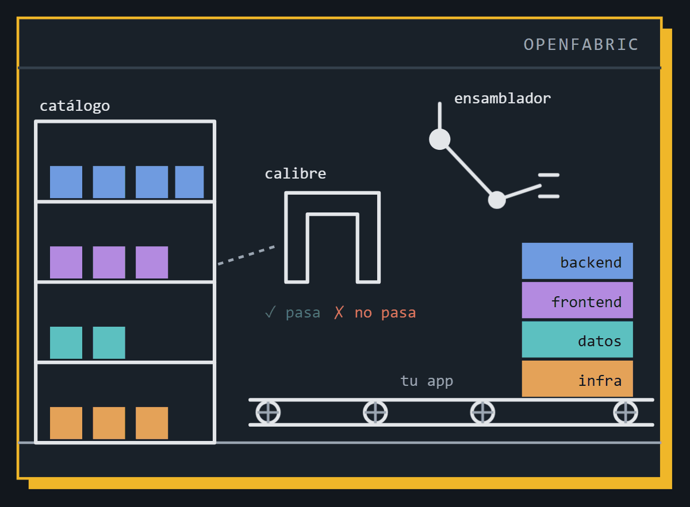

# Quise demostrar que mi idea estaba mal. Una parte se rompió, y esa es la buena noticia

A la 1 de la mañana me quedé sin tokens por segunda vez.

Esta es la historia de dos semanas probando una idea: lo que encontré, el camino que no era y por dónde sigo.

## La fábrica

En la época del vapor, las cosas se hacían a medida, una por una. Con la electricidad, durante un tiempo no cambió nada: un motor eléctrico haciendo las mismas piezas desde cero, con mucha más velocidad pero no más productividad. Hasta que llegó la línea de ensamblaje: piezas ya probadas, una línea que las arma y un control de calidad que decide qué sale y qué no.

Hoy la inteligencia artificial programa como un artesano. Todo desde cero, cada vez. Y a veces entrega algo que parece bueno y no lo es.

Esta apuesta es OpenFabric: que la IA trabaje como una fábrica. Que arme con piezas ya verificadas, que solo escriba el pedacito que falta, y que un control de calidad, al que llamo "el calibre", diga si eso pasa o no pasa.

## No me la quise creer

¿Buena idea no?

Pues no me la creí :v

A la IA con la que trabajo le puse una regla: no quiero que me des la razón, quiero números. Y antes de medir nada dejamos publicado qué resultado me daría la razón y cuál me la quitaría. Así no hay cómo acomodar la historia después.

## Lo que hicimos en dos semanas

Un banco de pruebas: un servicio de pagos, un juez oculto de 47 pruebas que la IA nunca ve, y una IA pequeña corriendo en mi computador de casa. Costo en servicios de IA: cero.

Con eso medimos dos caminos.

## El camino que no era

**Darle todo el trabajo a la IA.** Le pedimos el servicio completo 34 veces. Correctos: cero.

**Mostrarle las pruebas y dejarla corregir.** Cien repeticiones llenando una sola función. Con las pruebas a la vista acertó 19 de 50. Sin ellas, 21 de 50. Y cuando se equivocó y la dejamos reintentar, no arregló ni un error: 24 de 24 quedaron igual.

## De qué nos dimos cuenta

**El tamaño del hueco manda.** Con el servicio entero: 0 de 34. Con un solo hueco y todo lo demás ya armado: 40 de 100. La misma IA.

**No lee la letra pequeña.** La firma de un pago debía empezar con "sha256=". Estaba escrito en la tarea. En 70 intentos no lo puso ni una vez, ni cuando le mostramos qué prueba fallaba.

**A veces acierta sin entender.** En el descuento escribió el mismo código en Python y en JavaScript. En Python quedó bien 9 de 10 veces; en JavaScript, 0 de 10. ¿La diferencia? Python redondea por defecto justo como pedía la regla. La IA no la aplicó en ninguno de los dos.

**El calibre avisa, no arregla.** Con el calibre completo, el código malo que pasaba sin aviso bajó de 23 a 13 de cada 50. Pero toda esa mejora salió de una sola de las cinco funciones.

En una fábrica el control de calidad no hace que la máquina corte mejor. Impide que la pieza mala salga a la calle.

## Por dónde sigo

Tres tesis, todavía por probar:

1. **El motor.** Con un modelo más inteligente, la historia cambia.
2. **La regla pegada a la pieza.** Si la IA no lee la letra pequeña, cada pieza debe traer sus reglas encima, no perdidas en un documento largo.
3. **Que lo fácil sea lo correcto.** Python acertó el descuento sin querer. Si la pieza ya trae resuelto lo delicado, hasta una IA pequeña lo hace bien.

Voy a contar cada experimento aquí, salga bien o salga mal.

## Los números

- Modelo: Qwen2.5-Coder 7B, cuantizado a 4 bits, en una RTX 2070 de 8 GB
- 100 repeticiones, 954.079 tokens, 3 horas y 40 minutos
- 2 tecnologías (Next.js y Django), 5 funciones, juez oculto de 47 pruebas
- Código correcto: 19 de 50 con pruebas, 21 de 50 sin ellas. Tesis refutada
- Decisión "pasa o no pasa" acertada: 37 de 50 contra 27 de 50 (p = 0,0018). Tesis respaldada
- Reglas publicadas antes de medir, datos y registro completo: https://github.com/krespokiller/Open-Fabric

## Referencias

- M. D. McIlroy, "Mass Produced Software Components", conferencia de la OTAN, 1968. La idea original de una industria de componentes
- T. X. Olausson y otros, "Is Self-Repair a Silver Bullet for Code Generation?", ICLR 2024. La autocorrección rinde poco cuando se cuenta su costo
- J. Liu y otros, "Is Your Code Generated by ChatGPT Really Correct?", NeurIPS 2023. Con 80 veces más pruebas, el código "correcto" de los modelos cae entre 19% y 29%

*"Del fracaso se aprende, del éxito no mucho." Aunt Billie, La familia del futuro*
