# Vision

OpenFabric claims that software built with AI should come off a factory line, not out of a workshop. Today an AI agent writes every system from scratch and made to measure. In the factory, the agent assembles verified pieces, the model writes only the small gaps, and a gauge (contract plus tests) decides pass or no pass.

This is a claim under test, not a product. Nothing of the product is built. The owner confirmed this purpose on 2026-11-17 and set the order of work: research first, with the research as the means to a real product. How a claim becomes a verdict is in [`method.md`](method.md).

## From workshop to factory

| Plate | In the factory | In software |
| --- | --- | --- |
| 1. Made to measure (steam) | A central shaft drives the workshop and every part is filed until it fits | Every team writes its own checkout, webhook and login by hand |
| 2. Faster, same workshop (dynamo) | The first electric factories swapped the boiler for a motor and changed nothing else | The agent writes every system from scratch, in every project |
| 3. Parts and a gauge | The factory is redesigned around interchangeable parts | Software is assembled from pieces that are known to work |

**The dynamo paradox.** The first electric factories gained almost no productivity for decades (Paul David, "The Dynamo and the Computer", 1990). The gain came when the factory was redesigned around interchangeable parts. What made the parts interchangeable was the go/no-go gauge.

**The reading for AI.** Today AI is that motor placed in the old workshop. OpenFabric is the redesigned factory: a catalog of pieces, a gauge that says whether a piece works in any stack, and the agent as the assembler.

**Scope.** The vision covers the whole product: backend, frontend, data and infrastructure, each layer with its own gauge. The work starts with the backend because the gauge is sharpest there.

The image has a Spanish version, [`img/de-taller-a-fabrica.svg`](img/de-taller-a-fabrica.svg). The top-level [`README.md`](../README.md) tells the same story for a first-time reader.

## The production line

On 2026-11-16 the owner described the product as a production line in a single stack: an AI-first replacement for something like Django, where the model is the robotic arm that assembles and customizes. The record of that day states the philosophy in seven points.

| # | Point | What it means |
| --- | --- | --- |
| 1 | The line is fixed | The stack defines the stations: data, API, screen, deployment |
| 2 | There is one catalog of pieces | Verticals (fintech, live sales, streaming) are blueprints that combine pieces, not separate packages. A real app mixes several |
| 3 | The factory floor is not a piece | Tenants, auth and contracts come with the base, and every piece respects them |
| 4 | The agent is the robotic arm | The developer brings it (Claude Code, Codex, OpenCode, Pi). It assembles and customizes |
| 5 | The gauge has two forms | The catalog gauge comes with the piece and covers the generic part, which is installed without a model. The business gauge comes out of a conversation with the LLM: rules with approved examples, which are the production order |
| 6 | Every piece brings its business questions | A gap is an unanswered question |
| 7 | The agent does not touch the gauges or the order | Nothing moves forward without passing the gauge |

The owner's statement of that day adds three details:

- Vertical packages (fintech, streaming, gaming) are installed with one command, like `npx`.
- The stack is written in Go or Rust and has a good-looking frontend.
- The person who approves the business gauge may be non-technical, for example a CEO.

**Status.** The single stack is the product direction the owner stated on 2026-11-16. Since 2026-11-17 the research treats the stack as an experimental factor, and the product stack is chosen from the results. See [`decisions.md`](decisions.md#single-stack-and-the-three-promises).

## How the pieces reach the agent

| Part | What it does | Source |
| --- | --- | --- |
| Catalog | Holds the verified pieces | First description, 2026-11-08 |
| Assembler | Installs a piece deterministically, with an adapter per stack (routes, migrations, registration). The model does not do the mounting | Decision of 2026-11-09 |
| Agent connection | The developer's agent searches, selects and assembles pieces. Integration through a CLI first and MCP later | First description (MCP), then the owner on 2026-11-16 |
| Verifier | Decides whether a gap written by the model passes. The gauge is within reach while the agent works, not only at the end | First description, then the decision of 2026-11-09 |

In the first description every piece has two layers:

- **Contract and tests.** They work for any stack and they are what judges.
- **Ready code.** Only for one or two stacks at the start.

## The catalog

**Levels**, from small to large: atoms, molecules, organisms, architectures and blueprints.

**Verticals** are combinations of the catalog, not separate products.

| Source | Verticals named |
| --- | --- |
| First description (2026-11-08) | Store, fintech, LMS, condominium management (*propiedad horizontal*), occupational health and safety (*SST*) |
| Production-line record (2026-11-16) | Fintech, live sales, streaming |
| Owner's statement (2026-11-16) | Fintech, streaming, gaming |

The pieces are generic. Fintech is one vertical among several, not the product.

## The three promises

Each promise is a thesis to test, not a fact. The owner confirmed on 2026-11-17 that all three stand as claims under test. The registry is [`theses.md`](theses.md).

| # | Promise | Claimed mechanism | Theses that test it | Evidence so far |
| --- | --- | --- | --- | --- |
| 1 | Fewer tokens to reach correct software | The agent assembles, and the model writes only the small gaps | T1, T13, T16. T9 was discarded | None. T1 ended undecidable. Published research is a risk for this promise |
| 2 | Vague prompts that still work | Architectures and blueprints bring default decisions, and pieces bring their business questions | T17, which replaces T5 | None. Not run |
| 3 | It works in any stack, including legacy | The contract and the tests work for any stack | T20, which replaces T4. T21 is related | The reference passes every suite in four stacks. In the pilot, the arm with the piece installed failed at mounting it into the framework |

The risks behind promises 1 and 3 are recorded in [`decisions.md`](decisions.md#single-stack-and-the-three-promises).

## What OpenFabric does not promise

It does not promise a one-shot build of any software. That cannot be sustained. The message is that the boring and dangerous part comes out verified and the gaps stay explicit.
